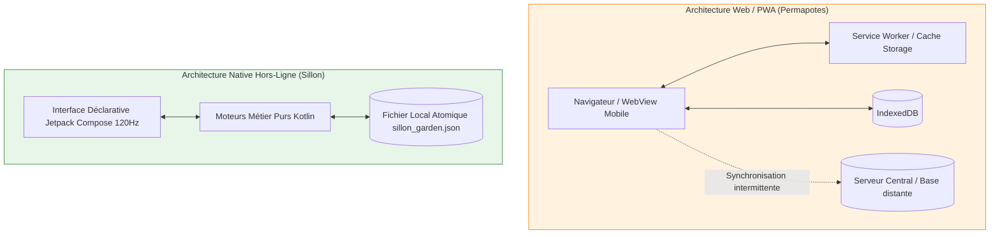

# Audit Concurrentiel & Analyse Critique du Marché Numérique du Jardinage

> **Document de référence stratégique et agronomique — Pilmil Studio**  
> **Auteur :** Pôle Stratégie & Ingénierie Logicielle Éthique  
> **Cible de positionnement :** *Sillon — Potager vivant, planification au carré & calendrier phénoclimatique*  
> **Licence :** Document interne / Open Documentation (CC BY-SA 4.0)  
> **Date de publication :** Novembre 2026  

---

## 1. Préambule & Contexte : L'impasse des applications maraîchères contemporaines

Le jardinage vivrier et l'horticulture amateure connaissent un regain sans précédent en Europe et dans le monde, porté par une aspiration légitime à l'autonomie alimentaire, à la résilience écologique et au ressourcement sensoriel. Face à cet engouement, l'écosystème numérique des boutiques d'applications (*Google Play Store*, *Apple App Store*) s'est rapidement saturé d'outils mobiles prétendant « simplifier » le potager.

Pourtant, un examen méthodique de ces solutions révèle une rupture profonde entre les promesses de marketing numérique et les réalités du vivant. Le marché est aujourd'hui polarisé entre :
1. **Les extracteurs de rente prédateurs** (ex. *PictureThis*), reposant sur des interfaces trompeuses (*dark patterns*), des abonnements récurrents exorbitants et une captation algorithmique fermée nécessitant un flux réseau ininterrompu.
2. **Les planificateurs à grille séquestrée** (ex. *Planter*), offrant une ergonomie séduisante mais bridant artificiellement l'usage gratuit, asservissant les données à des comptes distants et ignorant la complexité biochimique du sol et des pathologies végétales.
3. **Les applications web communautaires** (ex. *Permapotes*), animées d'une excellente intention permaculturelle mais pénalisées par une architecture web/PWA manquant de fluidité native, tributaires d'un compte distant et charriant un corpus d'associations folkloriques non validées scientifiquement.
4. **Les minuteurs calendaires mécaniques** (ex. *Planta*, *Gardenize*), dictant des fréquences d'arrosage immuables déconnectées de la pédologie, de la météo et du paillage, conduisant tout droit à l'asphyxie radiculaire et à l'épuisement mental du jardinier.
5. **Les marchands d'illusion biodynamique** (ex. *Moon & Garden*), recyclant les dogmes anthroposophiques de Rudolf Steiner et le calendrier zodiacal de Maria Thun, au détriment des véritables lois biophysiques de la thermopériode ($T_{\text{base}}$) et des risques statistiques de gelées printanières.

Le présent audit a pour vocation de déconstruire avec rigueur ces cinq paradigmes défaillants, d'analyser les doléances réelles des jardiniers de terrain, et d'exposer en détail l'**« Unfair Advantage »** agronomique, technique et éthique de **Sillon**.

---

## 2. Matrice Comparative Exhaustive

| Critère d'évaluation | PictureThis (Glority) | Planter: Garden Planner | Permapotes (Web/PWA) | Planta / Gardenize | Moon & Garden / Lune | **Sillon (Pilmil Studio)** |
| :--- | :--- | :--- | :--- | :--- | :--- | :--- |
| **Respect de la vie privée & Traceurs** | Déplorable (Trackers publicitaires, EXIF photos téléversées, profilage) | Moyen (Traceurs analytiques Google/Firebase, compte obligatoire) | Acceptable (Pas de revente, mais compte cloud centralisé obligatoire) | Médiocre (Trackers marketing, notifications de rétention agressive) | Déplorable (Bannières publicitaires invasives, SDKs tiers) | **Absolu (Zéro traceur, zéro télémétrie, aucune permission réseau)** |
| **Fonctionnement 100 % Hors-Ligne** | Impossible (Triage par vision artificielle hébergée sur cloud) | Partiel (Cache local fragile, blocage lors de synchronisations) | Instable (PWA sensible à l'éviction de cache par le navigateur mobile) | Partiel (Notifications locales mais synchronisation cloud requise) | Partiel (Publicités nécessitant le réseau, calculs d'éphémérides locaux) | **Total (Zéro requête réseau, APK sans permission `INTERNET`, 100 % autonome)** |
| **Modèle économique & Coût réel** | Prédateur (30 à 49 €/an, dark patterns de conversion forcée) | Freemium restrictif (1 seul potager gratuit, 24,99 à 29,99 €/an sinon) | Don / Abonnement soutien (Modèle associatif / indépendant bienveillant) | Abonnement récurrent (35 à 45 €/an pour débloquer le diagnostic) | Freemium publicitaire (Abonnement pour retirer des bannières criardes) | **Éthique & Gratuit (Logiciel Libre GPL-3.0, zéro abonnement, zéro paywall)** |
| **Planification spatiale en carrés (SFG)** | Inexistante (Uniquement reconnaissance unitaire) | Très bonne interface (Grille SFG interactive et agréable) | Moyenne (Grille web manquant de réactivité tactile sur mobile) | Inexistante (Simple liste linéaire de pots/planches) | Inexistante (Simple agenda lunaire temporel) | **Native & Fluide (Compose 120 Hz, carrés 30×30 cm, parcelles libres & modulaires)** |
| **Rigueur agronomique & Bases thermiques** | Nulle (Aucune prise en compte de la température de base du sol) | Rudimentaire (Dates fixes par zone de rusticité USDA sans dynamique) | Empirique (Calendrier moyen indicatif, sans moteur phénoclimatique) | Dangereuse (Minuteurs rigides ignorant précipitations et sol) | Pseudoscience (Zodiaque, lunes ascendantes/descendantes, astrologie) | **Haute précision ($T_{\text{base}}$ germination, médiane des dernières gelées, DJC)** |
| **Matrice de compagnonnage** | Absente | Binaire superficielle (Icônes sans justification biochimique) | Participative / Folklore (Mélange de données réelles et croyances non vérifiées) | Absente | Ésotérique (Associations dictées par les éléments astrologiques) | **Biologique & Spatiale (Allélopathie, répulsion olfactive, 2D direct/diagonal)** |
| **Diagnostic phytosanitaire** | Biaisé (Réseaux de neurones confondant carences minérales et champignons) | Absent | Absent (Forum communautaire externe uniquement) | Simpliste (QCM sommaire poussant vers l'achat d'engrais partenaires) | Absent | **Clinique & Déterministe (Arbre multicritère Organe × Famille × Symptômes, biocontrôle)** |
| **Sauvegarde & Souveraineté des données** | Verrouillée dans le cloud propriétaire | Compte captif (Export propriétaire difficilement exploitable) | Base de données distante liée au compte utilisateur | Données hébergées sur serveurs distants propriétaires | Aucun export propre | **Fichier JSON local atomique, import/export en un geste, zéro compte** |

---

## 3. Déconstruction Analytique des Acteurs Dominants

### 3.1. PictureThis (Glority Global / Pepl Inc.) : L'illusionniste prédateur du cloud

*PictureThis* s'est imposé comme l'application grand public de reconnaissance florale la plus visible sur les stores mobiles, cumulant plus de 100 millions d'installations. Sous son vernis d'intelligence artificielle bienveillante, l'application constitue l'un des cas d'école les plus documentés de monétisation prédatrice et de capture de données.

```
+-----------------------------------------------------------------------------------+
|                        Entonnoir d'Extraction PictureThis                         |
+-----------------------------------------------------------------------------------+
|  1. Téléchargement "Gratuit" sur le Store                                         |
|     ↓                                                                             |
|  2. Premier lancement : Écran d'onboarding anxiogène ("Votre plante va mourir")   |
|     ↓                                                                             |
|  3. Paywall d'activation obligatoire :                                            |
|     - Bouton géant "Commencer l'essai gratuit de 7 jours" (39,99 €/an ensuite)     |
|     - Bouton de fermeture 'X' gris clair sur fond blanc, opacité 30%, hors champ |
|     ↓                                                                             |
|  4. Si l'utilisateur contourne : Quota strict de 1 à 2 scans gratuits             |
|     ↓                                                                             |
|  5. Verrouillage brutal : Révocation de l'accès tant que la CB n'est pas saisie   |
+-----------------------------------------------------------------------------------+
```

#### Les Dark Patterns et le modèle économique
L'ensemble du parcours utilisateur de *PictureThis* est articulé autour de mécanismes trompeurs (*deceptive design patterns*) répertoriés par les observatoires internationaux de protection des consommateurs :
* **Le faux écran d'accueil obligatoire :** Dès l'ouverture, l'application présente une page d'abonnement annuelle (30 à 49,99 €/an selon le profil de tarification dynamique A/B testé). Le bouton de fermeture permettant d'accéder au mode gratuit est délibérément dissimulé (police microscopique, absence de contraste, temporisation de plusieurs secondes avant apparition).
* **Le piège du renouvellement d'essai gratuit :** L'essai de 7 jours souscrit via Google Play ou l'App Store se transforme automatiquement en débit annuel non remboursable par l'éditeur. Les avis sur les plateformes pullulent de plaintes d'utilisateurs âgés ou néophytes ayant été débités sans avoir compris qu'ils s'engageaient sur un abonnement récurrent.
* **Le renvoi de responsabilité :** Lorsque l'utilisateur désinstalle l'application en pensant annuler son abonnement, la facturation continue. Glority Global renvoie systématiquement la responsabilité vers Apple et Google, rendant tout remboursement direct impossible.

#### Dépendance absolue au cloud et pillage de données
*PictureThis* ne réalise aucun calcul de reconnaissance en local. Chaque photographie prise par l'utilisateur est transmise à des fermes de serveurs situées à l'étranger (notamment en Asie et aux États-Unis). 
* **Zone blanche au potager :** Le maraîcher travaillant sur une parcelle rurale, un jardin ouvrier périurbain mal couvert ou sous une serre métallique se heurte au message bloquant : *« Erreur réseau, veuillez vérifier votre connexion »*. L'outil est rendu inopérant à l'endroit exact où il est nécessaire.
* **Extraction de métadonnées :** Les clichés téléversés contiennent les métadonnées géographiques EXIF précises de l'utilisateur, permettant de géolocaliser des propriétés privées, des collections végétales rares ou des vergers familiaux sans consentement éclairé explicite.

#### Faiblesses agronomiques criantes
L'analyse phytosanitaire de *PictureThis* repose sur des réseaux de neurones convolutionnels (CNN) entraînés sur des images brutes d'Internet. Ce modèle souffre de biais d'interprétation critiques :
* **Confusion entre carences abiotiques et attaques parasitaires :** Une feuille de tomate présentant un jaunissement internervaire dû à une chlorose ferrique (pH de sol trop calcaire bloquant le fer assimilable) ou un dessèchement apical (*cul noir* consécutif à un stress hydrique entravant l'absorption du calcium) est fréquemment diagnostiquée comme un champignon cryptogamique (*Septoria lycopersici* ou *Alternaria solani*).
* **Surconsommation chimique induite :** Guidé par un faux diagnostic d'infection fongique, le jardinier amateur est incité à pulvériser des sels de cuivre (bouillie bordelaise), toxiques pour la mésofaune du sol et les vers de terre, pour un problème purement hydrique ou textural.
* **Inexistence des fonctions potagères :** *PictureThis* ignore totalement l'organisation parcellaire, les rotations de cultures, le calendrier de semis par rapport aux gelées locales et le compagnonnage végétal.

---

### 3.2. Planter: Garden Planner : L'ergonomie au service du verrouillage captif

*Planter* (développé par Curious Bee Apps) bénéficie d'une réputation méritée auprès de la communauté anglophone pour la propreté de son interface de dessin de potager au carré (*Square Foot Gardening*). Néanmoins, une analyse approfondie de son architecture et de ses choix fonctionnels démontre une stratégie délibérée de capture de l'utilisateur.

```
┌──────────────────────────────────────────────────────────────────┐
│                   PLANTER : ARCHITECTURE ET LIMITES              │
├───────────────────────────────────────────────────┬──────────────┤
│  Fonctionnalité                                   │ Évaluation   │
├───────────────────────────────────────────────────┼──────────────┤
│  Interface de grille carrée                       │ Très bonne   │
│  Version gratuite                                 │ 1 parcelle   │
│  Modèle économique (24,99 à 29,99 €/an)           │ Payant       │
│  Dépendance au compte cloud                       │ Obligatoire  │
│  Moteur de compagnonnage biologique               │ Binaire      │
│  Moteur de rotation des cultures                  │ Inexistant   │
│  Diagnostic phytosanitaire                        │ Inexistant   │
│  Pérénité des données (Export universel JSON)     │ Aucune       │
└───────────────────────────────────────────────────┴──────────────┘
```

#### Le modèle freemium d'étouffement
*Planter* applique une restriction artificielle sévère à son niveau gratuit :
* **Le plafond du potager unique :** L'utilisateur gratuit ne peut créer qu'**un seul potager**. Pour peu qu'un jardinier dispose de deux bacs surélevés distincts, d'une planche en pleine terre et d'une serre, il est contraint d'agglutiner artificiellement tous ses espaces dans un plan unique monstrueux ou de souscrire à l'abonnement annuel (*Planter Pro* à environ 25 à 30 €/an ou un achat unique prohibitif avoisinant 100 à 130 €).
* **Le verrouillage des tâches calendaires :** Les rappels de semis et les alertes d'échelonnement sont verrouillés derrière la barrière payante, réduisant la version gratuite à un simple carnet de dessin passif.

#### Captivité des données et dépendance cloud
*Planter* conditionne l'accès multi-plateformes et la sauvegarde à la création d'un compte distant (authentification Google, Apple ou email). 
* **Séquestration du schéma :** Les potagers dessinés ne peuvent pas être exportés sous forme de schéma de données ouvert (JSON/YAML) directement exploitable par un autre outil. Si le développeur modifie ses tarifs, cesse l'exploitation du service ou coupe les serveurs, le jardinier perd l'historique complet de ses parcelles et rotations.

#### Les lacunes agronomiques sous le design
Bien que la grille au carré soit ergonomique, le moteur agronomique sous-jacent demeure extrêmement simpliste :
1. **Compagnonnage superficiel et non motivé :** Le compagnonnage est représenté par une binarité naïve (pouce vert / pouce rouge). L'application n'indique jamais le *pourquoi* biologique de l'interaction (s'agit-il d'une compétition racinaire sur le même horizon de sol, d'une allélopathie inhibitrice par exsudats racinaires, d'un partage d'ennemis communs ou d'une répulsion volatile des ravageurs ?).
2. **Absence de rotation pluriannuelle rigoureuse :** La gestion de l'historique d'assolement sur 3 à 5 ans pour éviter les nématodes à kystes ou la hernie des crucifères (*Plasmodiophora brassicae*) n'est pas automatisée avec vérification des familles botaniques.
3. **Zéro diagnostic sanitaire :** Face à une pourriture grise (*Botrytis cinerea*) ou une attaque d'altises, *Planter* n'offre aucun support d'identification ni protocole curatif biologique.

---

### 3.3. Permapotes : Les limites techniques de l'approche Web/PWA communautaire

*Permapotes* est un projet français remarquable par son éthique de partage, son esprit d'entraide permaculturelle et sa communauté vivante. Développé initialement comme une plateforme web interactive, il a conquis des dizaines de milliers de jardiniers francophones. Cependant, ses choix d'architecture technique imposent des limites structurelles que le jardinier de terrain subit au quotidien.



#### Friction ergonomique sur smartphone et instabilité hors-ligne
* **Performances graphiques et gestuelles :** En tant qu'application web progressive (PWA) ou encapsulée dans une *WebView*, la manipulation d'une grille potagère dense (plusieurs dizaines de parcelles, affichage de pictogrammes complexes) souffre de ralentissements notables sur les smartphones d'entrée et milieu de gamme. Le *pinch-to-zoom*, le panoramique au doigt et le glisser-déposer de légumes manquent de la réactivité immédiate et des retours haptiques subtils que permet une interface native sous Jetpack Compose.
* **Fragilité de la persistance hors-ligne :** Même si un *Service Worker* met en cache les fichiers statiques de l'application, le stockage local des navigateurs mobiles (*IndexedDB* / *LocalStorage*) est soumis aux règles drastiques de gestion de mémoire des systèmes Android et iOS. Lorsqu'un téléphone arrive à saturation d'espace de stockage, le système d'exploitation purge unilatéralement les caches des navigateurs web, exposant le jardinier à la disparition de ses données locales s'il n'a pas synchronisé en ligne.
* **Compte centralisé requis :** Pour sauvegarder son plan et retrouver son potager d'une saison à l'autre, la création d'un compte sur le serveur de *Permapotes* demeure obligatoire, centralisant les données individuelles sur une infrastructure distante.

#### Dérive folklorique de la matrice de compagnonnage participative
Le modèle communautaire participatif (*crowdsourcing*) de *Permapotes* présente le revers de sa force :
* **Diffusion de mythes horticoles non sourcés :** Dans la littérature populaire du jardinage, de nombreuses associations végétales relèvent de la tradition orale ou de compilations successives d'ouvrages sans contrôle expérimental en double aveugle. En ouvrant la matrice aux avis communautaires, on y retrouve des affirmations contradictoires (ex. telle plante déclarée compagne idéale sur un fil, et toxique sur un autre).
* **Manque de pondération agronomique :** L'association bénéfique de surface (ex. basilic planté au pied des tomates) est souvent surévaluée par rapport aux paramètres déterminants réels (aération du feuillage, ensoleillement, hydratation régulière).

---

### 3.4. Planta & Gardenize : L'aberration agronomique des minuteurs calendaires rigides

*Planta* (Strömbom & Yembid AB) et *Gardenize* (Gardenize AB) incarnent une dérive technologique particulièrement néfaste pour le vivant : **la mécanisation aveugle de l'arrosage par minuteur calendaire**.

```
                L'ABSURDITÉ DU MINUTEUR RIGIDE D'ARROSAGE
                
       Notification Planta : « Il est temps d'arroser votre Tomate ! »
                                 │
              ┌──────────────────┴──────────────────┐
              ▼                                     ▼
        Cas Réel n°1                          Cas Réel n°2
  ┌─────────────────────────┐           ┌─────────────────────────┐
  │ Pluie d'orage de 40 mm  │           │ Canicule 38°C + Mistral │
  │ hier soir sur le jardin │           │ Sol sablonneux nu       │
  │ Sol lourd, paillé 10 cm │           │ Évapotranspiration max  │
  └─────────────────────────┘           └─────────────────────────┘
              │                                     │
              ▼                                     ▼
      Application suivie :                  Application suivie :
      - Asphyxie des racines                - Arrosage superficiel
      - Fonte du collet / Pythium           - Stress hydrique sévère
      - Mort de la plante                   - Perte de floraison
```

#### La physique du sol ignorée au profit du code binaire
L'eau dans le sol n'obéit pas à une horloge atomique, mais aux lois fondamentales de la physique des sols et de la bioclimatologie végétale :
1. **L'évapotranspiration potentielle ($ET_0$) et réelle ($ET_R$) :** Les besoins en eau d'une culture dépendent de la demande évaporative de l'atmosphère, régie par l'équation de Penman-Monteith (rayonnement solaire net, température de l'air, vitesse du vent, déficit de pression de vapeur $VPD$). Entre une journée couverte à 18 °C avec 80 % d'humidité relative et un après-midi de plein été à 35 °C balayé par un vent sec, la consommation en eau d'un plant de courgette varie d'un facteur 1 à 6 !
2. **La texture du sol et la Réserve Utile ($RU$) :** Un sol sableux grossier dispose d'une rétention en eau infime (environ 0,7 à 1 mm d'eau par centimètre de profondeur de sol) et draine en quelques heures. À l'inverse, un sol argilo-limoneux riche en matière organique stocke jusqu'à 2 mm d'eau par centimètre et retient l'humidité disponible pendant plus d'une semaine.
3. **Le rôle fondamental du paillage (*mulch*) :** Une couverture permanente de paille, broyat de bois raméal (BRF) ou foin de 10 cm d'épaisseur réduit l'évaporation directe de surface du sol de **60 % à 80 %**. Envoyer une notification d'arrosage « tous les 3 jours » sans savoir si le sol est nu ou paillé constitue une faute agronomique majeure.

#### Les conséquences délétères : Asphyxie radiculaire et anxiété de l'utilisateur
* **Pathologies induites par le surarrosage :** En suivant aveuglément les notifications de *Planta*, les jardiniers néophytes maintiennent le substrat dans un état d'anoxie permanent. Privées d'oxygène, les radicelles nécrosent, ouvrant la porte aux oomycètes pathogènes telluriques (*Pythium ultimum*, *Phytophthora cactorum*). Les feuilles jaunissent par asphyxie, ce que le jardinier interprète souvent... comme un manque d'eau, amplifiant le désastre.
* **La fatigue attentionnelle (*Notification Fatigue*) :** Recevoir quotidiennement 10 notifications impératives affichant des badges rouges d'arriéré (*« 12 arrosages en retard »*) transforme une activité apaisante et émancipatrice en une corvée anxiogène. Les jardiniers finissent par couper les alertes ou désinstaller l'application par dégoût.

---

### 3.5. Moon & Garden / Calendriers Lunaires : La déconstruction du mythe biodynamique

Le jardinage lunaire, popularisé par les publications de Maria Thun issues de la « science spirituelle » (anthroposophie) de Rudolf Steiner formalisée en 1924, prétend dicter chaque intervention au potager selon la position de la Lune devant les constellations zodiacales et ses cycles ascendants/descendants, croissants/décroissants.

```
+------------------------------------------------------------------------------------+
|                CONFRONTATION : MYTHE LUNAIRE VS PHYSIQUE EXPÉRIMENTALE             |
+------------------------------------------------------------------------------------+
|  Prétention ésotérique (Biodynamie)  |  Réalité Biophysique & Agronomique          |
+--------------------------------------+---------------------------------------------+
| "La Lune attire l'eau des plantes    | Force gravitationnelle sur une graine :      |
|  comme les marées de l'océan."       | Infime (~10⁻⁸ N). Les forces de capillarité |
|                                      | et le potentiel matriciel du sol (Ψₘ) sont  |
|                                      | 10¹¹ fois plus puissants !                  |
|                                      |                                             |
| "Semer les carottes en jour-racine   | L'analyse métagénomique et phénotypique     |
|  pour concentrer l'énergie tellurique| (Mayoral et al. 2020) démontre une variance |
|  vers le bas."                       | strictement nulle par rapport au témoin.    |
|                                      |                                             |
| "Attendre la fin du nœud lunaire     | Attendre 4 jours pour un prétendu "nœud"    |
|  avant de semer, sinon pourriture."  | fait rater la pluie et le créneau thermique |
|                                      | optimal T_base, ruinant la levée.           |
+--------------------------------------+---------------------------------------------+
```

#### L'état de l'art scientifique : Un consensus peer-reviewed catégorique
La communauté scientifique internationale en biologie végétale et agronomie s'est penchée à plusieurs reprises sur les prétentions de l'agriculture biodynamique lunaire :
1. **L'étude de référence de Mayoral et al. (2020, Université de Valence) :**
   Publiée dans la revue internationale à comité de lecture *Agronomy* (*What Has Been Thought and Taught on the Lunar Influence on Plants in Agriculture? Perspective from Physics and Biology*), cette revue systématique exhaustive de la littérature scientifique conclut :
   > *« Il n'existe aucune preuve scientifique fiable d'une relation causale entre les phases lunaires et la physiologie ou le rendement des plantes cultivées. Les fondements physiques de la gravitation et de la luminosité lunaire écartent toute action mesurable face aux facteurs environnementaux dominants. »*
2. **Le rapport du Conseil Scientifique de la Société Nationale d'Horticulture de France (SNHF) :**
   Dans son dossier d'expertise *« Jardiner avec la lune : mythe ou réalité ? »*, coordonné par des professeurs et agronomes émérites :
   > *« Si la Lune a une influence sur les plantes, elle est infinitésimale. L'attribution de propriétés spécifiques aux constellations zodiacales (jours-racines, jours-fleurs, jours-feuilles, jours-fruits) ou aux nœuds lunaires relève de la pure croyance astrologique sans aucune assise biologique. Les professionnels du maraîchage ignorent ces cycles sans aucune altération de leur production. »*
3. **L'analyse critique de Linda Chalker-Scott (Washington State University) :**
   Dans ses travaux de vulgarisation agronomique académique (*The Myth of Curative Moon Gardening*), la chercheuse rappelle que les variations de lumière nocturne induites par la pleine lune (au maximum 0,1 à 0,3 lux au sol) sont des centaines de milliers de fois inférieures au seuil de saturation photosynthétique et ne sauraient enclencher de réponse photopériodique chez les plantes supérieures cultivées en présence de pollution lumineuse ou de couvert végétal.

#### La physique gravitationnelle : Une aberration d'échelle
L'argument récurrent des promoteurs du calendrier lunaire affirme : *« Si la Lune déplace des océans entiers par les marées, elle déplace nécessairement la sève des plantes. »*
Cet argument commet une faute élémentaire d'analyse dimensionnelle :
* L'effet de marée différentielle dépend directement de la dimension spatiale de la masse d'eau considérée ($F_{\text{marée}} \propto G \cdot M_{\text{lune}} \cdot R_{\text{corps}} / d^3$). Pour un océan de plusieurs milliers de kilomètres de diamètre, la force différentielle engendre des déplacements métriques d'eau liquide libre.
* Pour une plantule de carotte de 2 millimètres ou une gouttelette de sève de 100 micromètres logée dans un vaisseau conducteur de xylème, la force de marée exercée par la Lune est de l'ordre de $10^{-14}$ Newton.
* En regard, le **potentiel matriciel du sol ($\Psi_m$)** et les **forces capillaires d'adsorption** des parois cellulaires cellulosiques atteignent des pressions négatives oscillant entre $-10\text{ kPa}$ (capacité au champ) et $-1500\text{ kPa}$ (point de flétrissement permanent). Les forces hydriques internes à la plante sont **$10^{11}$ fois plus intenses** que n'importe quelle attraction gravitationnelle lunaire !

#### Le véritable coût d'opportunité agronomique
La croyance aveugle dans le calendrier lunaire n'est pas une simple curiosité inoffensive ; elle génère des pertes réelles au potager :
* **Semis manqués lors d'une météo favorable :** Un jardinier refuse de semer ses épinards ou ses pois un samedi parfait (terre réchauffée, sol ressuyé, pluie douce annoncée le lendemain) sous prétexte qu'il s'agit d'un « nœud lunaire » ou d'un jour « défavorable ». Les deux semaines suivantes sont marquées par un gel tardif ou un déluge rendant le sol impraticable.
* **Semis forcés en conditions impropres :** Le jardinier sème ses haricots parce que le calendrier affiche un « jour-fruits », alors que la température du sol est de seulement 8 °C. La graine pourrit sous terre faute d'atteindre le seuil thermique minimal de germination ($T_{\text{base}} \ge 12^\circ\text{C}$).

---

## 4. Retours du Terrain : Les Doléances Réelles des Jardiniers

Une veille attentive sur les plateformes d'avis (*Google Play Store*, *Apple App Store*), les salons de discussion spécialisés (*Reddit r/gardening, r/vegetablegardening, r/plantclinic*) et les forums francophones historiques (*Tomodori, Rustica, Terre Vivante*) met en lumière cinq souffrances universelles exprimées par les usagers des applications courantes :

### 1. La taxe surprise et la captivité commerciale (PictureThis, Planta)
> *« J'ai téléchargé l'application pour identifier une plante dans mon nouveau potager. Après deux photos, écran bloqué me demandant mes identifiants bancaires pour un essai. J'ai cru fermer avec la croix minuscule... j'ai été débité de 39,99 € trois jours plus tard ! C'est du vol pur et simple organisé par des développeurs sans scrupules. »*  
> — **Avis vérifié Google Play Store (PictureThis, France, 2025)**

> *« Je cherchais un carnet pour mes tomates. Planta m'a harcelé d'écrans pour passer à la version Premium à 45 € par an ! 45 euros pour me dire de verser de l'eau dans un pot, c'est le prix de mes semences pour les cinq prochaines années. »*  
> — **Fil Reddit r/houseplants, retour d'expérience application**

### 2. L'inutilité totale en zone blanche rurale
> *« Mon potager se situe sur une parcelle partagée à 2 km du village, en creux de vallon où il n'y a ni 4G ni 5G. Planter et PictureThis refusent tout simplement de s'ouvrir ou restent bloqués sur un spinner infini. J'ai besoin de mes notes et de mes plans là où j'ai les mains dans la terre, pas dans mon salon sur le Wi-Fi de la maison ! »*  
> — **Forum Tomodori / Tomates & Potager**

### 3. Les plantes massacrées par les minuteurs d'arrosage
> *« Planta m'a tué trois courgettes et un piment. L'application me disait d'arroser tous les 3 jours. J'ai suivi consciencieusement comme un idiot. Il avait plu toute la semaine, mon sol argileux était gorgé d'eau sous le paillage. Les racines ont complètement pourri noir au collet. Ces applications sont un poison pour les débutants qui ne savent pas encore tester la terre au doigt. »*  
> — **Discussion r/gardening, "Why you shouldn't use plant care scheduling apps"**

### 4. Les diagnostics "IA" délirants et pousse-au-crime chimique
> *« Mes feuilles de poivron commençaient à jaunir entre les nervures au mois de juin. PictureThis m'a diagnostiqué une rouille cryptogamique virulente avec recommandation de traitement cuprique immédiat. Heureusement, j'ai montré la feuille à mon grand-père jardinier : c'était une simple chlorose ferrique causée par mon eau d'arrosage trop calcaire. Un peu de purin d'ortie et du compost ont tout réglé en dix jours sans un gramme de produit chimique. »*  
> — **Groupe d'entraide permaculturelle Facebook**

### 5. La perte sèche des données après des années de saisie
> *« J'ai utilisé une application de planification pendant trois saisons complètes en y consignant l'emplacement de chaque salade, chaque carotte et le calendrier de mes récoltes. L'éditeur a changé de politique, a supprimé l'ancienne formule et m'a réclamé un abonnement mensuel pour accéder à mes propres archives. Aucune option d'exportation de fichier. Mes trois ans d'historique de rotation sont pris en otage. Plus jamais ! »*  
> — **Avis App Store, Jardinier urbain**

---

## 5. Le « Pilmil Unfair Advantage » : Pourquoi Sillon Redéfinit le Marché

Conçu par Pilmil Studio en rupture frontale avec les compromissions de l'industrie, **Sillon** n'est pas un nième gadget de divertissement numérique, mais un **instrument agronomique émancipateur**, libre (GPL-3.0), conçu pour durer des décennies sur l'appareil du jardinier sans jamais dépendre d'un serveur ni d'une entreprise tierce.

```
+───────────────────────────────────────────────────────────────────────────────+
|                  L'ÉCOSYSTÈME TECHNIQUE & SCIENTIFIQUE DE SILLON               |
+───────────────────────────────────────────────────────────────────────────────+
|                                                                               |
|   ┌────────────────────────┐  Zéro Permission INTERNET   ┌────────────────┐   |
|   │ 100% Hors-Ligne        │ ◄─────────────────────────► │ Sauvegarde     │   |
|   │ SQLite / Room Local    │                             │ JSON Atomique  │   |
|   └───────────┬────────────┘                             └────────┬───────┘   |
|               │                                                   │           |
|               ▼                                                   ▼           |
|   ┌───────────────────────────────────────────────────────────────────────┐   |
|   │                LES 4 MOTEURS AGRO-LOGIQUES PURS KOTLIN                │   |
|   ├───────────────────────────────────────────────────────────────────────┤   |
|   │  1. FrostEngine       : Modélisation thermique (T_base, Gelées, DJC)  │   |
|   │  2. CompanionEngine   : Allélopathie & géométrie spatiale 2D          │   |
|   │  3. RotationEngine    : Rupture sanitaire 4 ans & exigences sol       │   |
|   │  4. DiagnosticEngine  : Arbre clinique Organe x Famille x Symptômes   │   |
|   └───────────────────────────────────┬───────────────────────────────────┘   |
|                                       │                                       |
|                                       ▼                                       |
|   ┌───────────────────────────────────────────────────────────────────────┐   |
|   │ INTERFACE DÉCLARATIVE NATIVE JETPACK COMPOSE (Fluidité 120 Hz)        │   |
|   │ - Grille au carré (Square-Foot 30x30 cm) tactile et sensorielle       │   |
|   │ - Absence totale de minuteur rigide d'arrosage (Pédagogie du vivant)   │   |
|   │ - Accessibilité WCAG 2.2 AA / RGAA (Cibles 64 dp, contrastes > 4.5:1)  │   |
|   └───────────────────────────────────────────────────────────────────────┘   |
+───────────────────────────────────────────────────────────────────────────────+
```

### 5.1. Pilier 1 : Souveraineté Radicale & Zéro-Compte (L'Éthique Pilmil)
* **Manifeste Android vierge de toute permission réseau :** Le fichier `AndroidManifest.xml` de Sillon ne contient **aucune ligne `<uses-permission android:name="android.permission.INTERNET" />`**. L'application est techniquement dans l'incapacité matérielle d'émettre le moindre octet vers l'extérieur. C'est la garantie suprême, vérifiable et mathématique qu'aucune donnée de géolocalisation, aucune photo et aucun schéma de jardin ne quitte l'appareil.
* **Persistance transparente et atomique (`GardenRepository`) :** Le potager est persisté dans un fichier local `sillon_garden.json` par écriture atomique (écriture sur fichier temporaire puis renommage pour prémunir toute corruption en cas de coupure de batterie).
* **Export et Import universels en clair :** D'un simple clic depuis l'écran des réglages, le jardinier exporte son potager sous forme de flux JSON brut lisible par un être humain, librement partageable, stockable sur clé USB ou réimportable instantanément sur n'importe quel autre terminal Android, sans compte, sans mot de passe et sans validation cloud.

### 5.2. Pilier 2 : Le Moteur Phénoclimatique Thermique (`FrostEngine`)
Plutôt que d'imposer des dates calendaires arbitraires ou de surveiller le zodiaque lunaire, Sillon ancre toute sa dynamique temporelle sur les déterminants biophysiques réels de la plante :
1. **La température de base de germination ($T_{\text{base}}$) :** Chaque légume possède un seuil thermique en deçà duquel l'activité métabolique embryonnaire est nulle ou létale. Sillon intègre dans son catalogue agronomique les minima physiologiques exacts :
   * Tomate (*Solanum lycopersicum*) : $T_{\text{base}} = 12^\circ\text{C}$ (optimum $20-25^\circ\text{C}$, levée en 6 à 10 jours) ;
   * Piment / Aubergine : $T_{\text{base}} = 15^\circ\text{C}$ (levée impossible en sol froid) ;
   * Fève / Pois (*Fabaceae*) : $T_{\text{base}} = 4-5^\circ\text{C}$ (capacité de germination en fin d'hiver) ;
   * Carotte : $T_{\text{base}} = 8^\circ\text{C}$.
2. **Le calcul différentiel par rapport à la date de dernière gelée ($T_{\text{frost}}$) :** L'utilisateur renseigne sa date médiane locale de dernière gelée (catalogue intégré des départements français et des données historiques des stations Météo-France, modulable manuellement). Toutes les fenêtres de semis et repiquage sont calculées dynamiquement par rapport à ce pivot phénologique :
   $$\text{Date}_{\text{semis direct}} = T_{\text{frost}} + \Delta t_{\text{semaines}}$$
   $$\text{Date}_{\text{semis abri}} = T_{\text{frost}} - \Delta t_{\text{semaines}}$$
3. **Des fenêtres agronomiques par quinzaine, non culpabilisantes :** Sillon ne sonne jamais pour dire *« Vous devez semer aujourd'hui à 14h »*. Il propose des fenêtres d'opportunité d'une quinzaine de jours ($\pm 7\text{ jours}$ autour de la date cible idéale), incitant le jardinier à observer l'état réel de son sol (ressuyage, humidité) et la météo effective de la semaine avant d'agir.
4. **Le rejet délibéré du minuteur d'arrosage :** Sillon refuse catégoriquement d'intégrer des alertes d'arrosage à heure fixe. L'application transmet des fiches pédagogiques détaillant le test tactile du sol (enfoncer un doigt à 5 cm sous le paillage pour évaluer la fraîcheur) et valorise l'arrosage copieux et espacé au goulot au pied de la plante pour encourager l'enracinement profond, plutôt que l'aspersion quotidienne superficielle génératrice de cryptogames.

### 5.3. Pilier 3 : La Matrice Spatiale de Compagnonnage 2D (`CompanionEngine`)
Alors que les concurrents se bornent à une liste textuelle déconnectée du dessin de la planche, Sillon analyse en temps réel la topologie géométrique du potager :
* **Détection d'adjacence bidimensionnelle :** Le moteur distingue les relations d'adjacence directe (orthogonale : nord, sud, est, ouest) et les relations de proximité élargie (diagonale).
* **Fondement biochimique et physiologique rigoureux :** Chaque synergie ou antagonisme est explicité par son mécanisme agronomique réel :
  * **Répulsion olfactive croisée :** L'association Poireau (*Allium porrum*) + Carotte (*Daucus carota*) perturbe mutuellement la mouche de la carotte (*Psila rosae*) et la teigne du poireau (*Acrolepiopsis assectella*) par confusion des terpènes volatils émis.
  * **Symbiose fixatrice d'azote :** Les Fabacées (Pois, Haricots) enrichissent la rhizosphère en azote nitrique grâce à la symbiose avec les bactéries du genre *Rhizobium*, au bénéfice des cultures gourmandes compagnes.
  * **Étagement foliaire et racinaire :** Coexistence harmonieuse du Maïs (tuteur vertical), du Haricot grimpant (fixateur d'azote) et de la Courge (couvre-sol limitant l'évapotranspiration par ombrage dense), inspirée de la technique millénaire de la *Milpa* mésoaméricaine.
* **Alertes biologiques d'antagonisme :** Détection immédiate des associations à risque élevé (ex. Alliacées et Fabacées dont les exsudats soufrés entravent la nodulation rhizobienne, ou mise en contiguïté de Solanacées sensibles aux mêmes souches de mildiou *Phytophthora infestans*).

### 5.4. Pilier 4 : Le Moteur de Rotation Pluriannuelle (`RotationEngine`)
Le maraîchage biologique durable repose sur la rupture temporelle des cycles pathogènes du sol :
* **Gestion d'historique par case de grille :** Sillon mémorise l'historique d'implantation de chaque emplacement $(x, y)$ de parcelle sur plusieurs saisons consécutives.
* **Verrouillage sanitaire par famille botanique :** Si un jardinier tente d'implanter une Solanacée (tomate, pomme de terre, poivron) ou une Brassicacée (chou, radis, navet) sur un emplacement ayant accueilli la même famille botanique moins de 3 à 4 ans auparavant, le moteur génère une alerte de sévérité haute (*CONFLICT_ERROR*). Cela prévient mécaniquement l'accumulation de sclérotes de *Sclerotinia*, de spores dormantes de *Verticillium dahliae* et de nématodes phytophages.
* **Équilibrage des exigences trophiques :** Le moteur avertit le jardinier en cas de succession d'espèces hautement épuisantes pour le sol (ex. Courge succédant au Chou sans apport intermédiaire de compost mûr ou de précédent d'engrais vert régénérateur).

### 5.5. Pilier 5 : L'Arbre de Diagnostic Clinique Phytosanitaire (`DiagnosticEngine`)
Face aux hallucinations et approximations des modèles de vision par ordinateur hébergés sur le cloud, Sillon fait le choix d'un **arbre clinique déterministe hors-ligne**, inspiré des méthodes de diagnostic de l'INRAE :
* **Triage multicritère :**
  $$\text{Score} = f(\text{Organe Touché}, \text{Famille Botanique}, \text{Symptômes Sémantiques})$$
  L'utilisateur sélectionne l'organe affecté (feuille, collet, tige, fruit, système racinaire), la famille botanique de son végétal, et affine les manifestations visibles (poudre blanche, taches concentriques brunes, galle racinaire, pourriture molle, dessèchement apical).
* **Rémédiation 100 % Biologique & Préventive :** L'application exclut tout référencement de pesticides ou fongicides de synthèse. Elle oriente immédiatement le jardinier vers des solutions de biocontrôle éprouvées et des gestes culturaux prophylactiques :
  * Bicarbonate de potassium et soufre pour l'oïdium ;
  * Décoction de prêle (riche en silice renforçant la cuticule foliaire) pour stimuler les défenses immunitaires contre le mildiou ;
  * Aération immédiate de la structure de plantation, suppression chirurgicale et destruction hors-compost des feuilles atteintes ;
  * Correction des déséquilibres d'irrigation pour juguler la nécrose apicale du fruit sans intrants inutiles.

---

## 6. Synthèse des Exigences Métier pour Sillon

Afin de pérenniser cette supériorité agronomique et éthique, les spécifications techniques de Sillon doivent demeurer inflexibles :

1. **Intégrité du Manifeste :** Aucune inclusion future de SDK externe nécessitant des permissions réseau, de traçage publicitaire ou d'analyse comportementale. L'application doit compiler et fonctionner sans la moindre dépendance Google Play Services (compatible totale avec les dépôts F-Droid et IzzyOnDroid).
2. **Accessibilité Universelle :** L'interface sous Jetpack Compose doit scrupuleusement appliquer les standards d'accessibilité de Pilmil Studio (cibles tactiles élargies à 64 dp pour les interactions principales dans le jardin, corps de texte minimal à 15-18 sp lisible en plein soleil, contraste de couleurs supérieur à 4,5:1 dans les deux thèmes jour et nuit).
3. **Autonomie Cognitive du Jardinier :** Le logiciel doit éduquer plutôt qu'infantiliser. Toute recommandation doit expliciter son fondement agronomique et encourager l'observation sensorielle du vivant plutôt que l'obéissance aveugle à l'écran.

---

## 7. Conclusion

Le marché des applications de jardinage est aujourd'hui dominé par des solutions qui ont transposé les pires travers de l'économie numérique (rente d'abonnement, captivité des données, traçage publicitaire) sur l'une des activités humaines les plus nobles et intimement liées à la nature.

Par son refus absolu de la prédation financière, son fonctionnement 100 % hors-ligne, sa rigueur agronomique biophysique ($T_{\text{base}}$, gelées locales, allélopathie, rotations quadriennales) et son respect intransigeant de l'attention et de la vie privée du jardinier, **Sillon apporte une réponse salvatrice et révolutionnaire**. 

En rendant aux femmes et aux hommes qui cultivent la terre leur souveraineté numérique et le bon sens du vivant, Pilmil Studio démontre qu'une autre informatique est possible : sobre, libre, scientifique et profondément respectueuse.
